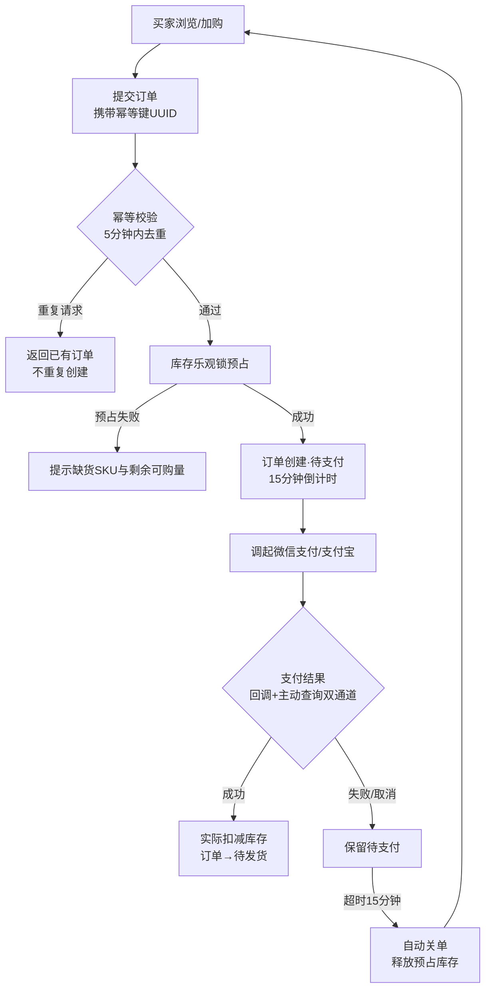
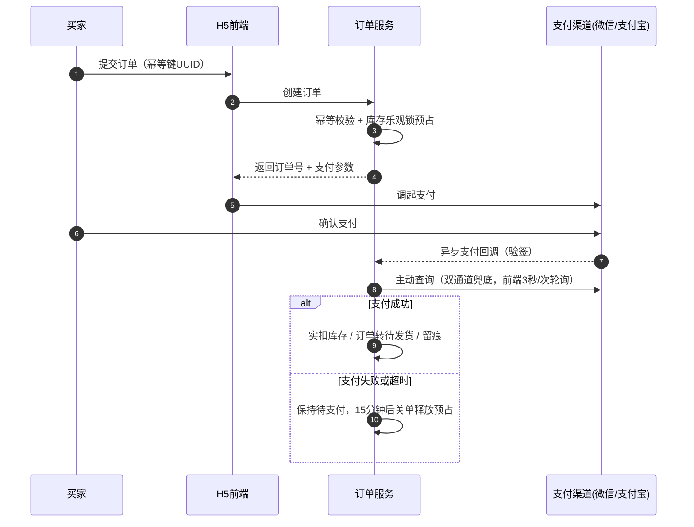
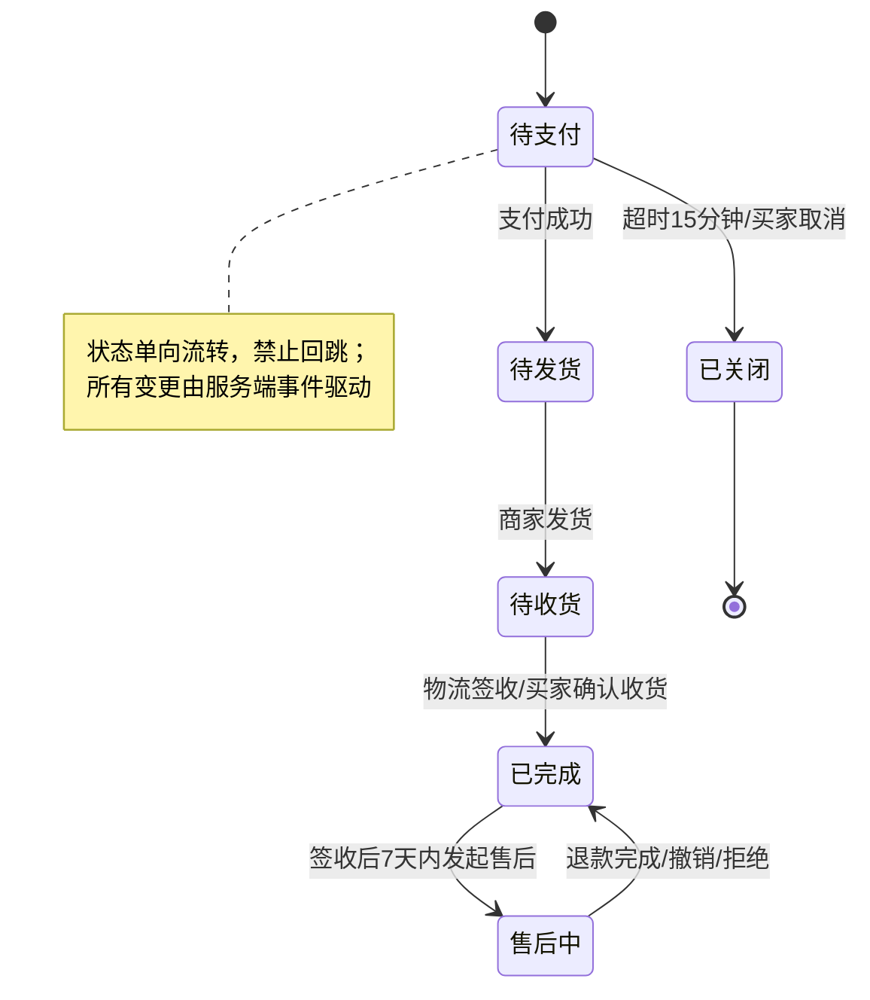
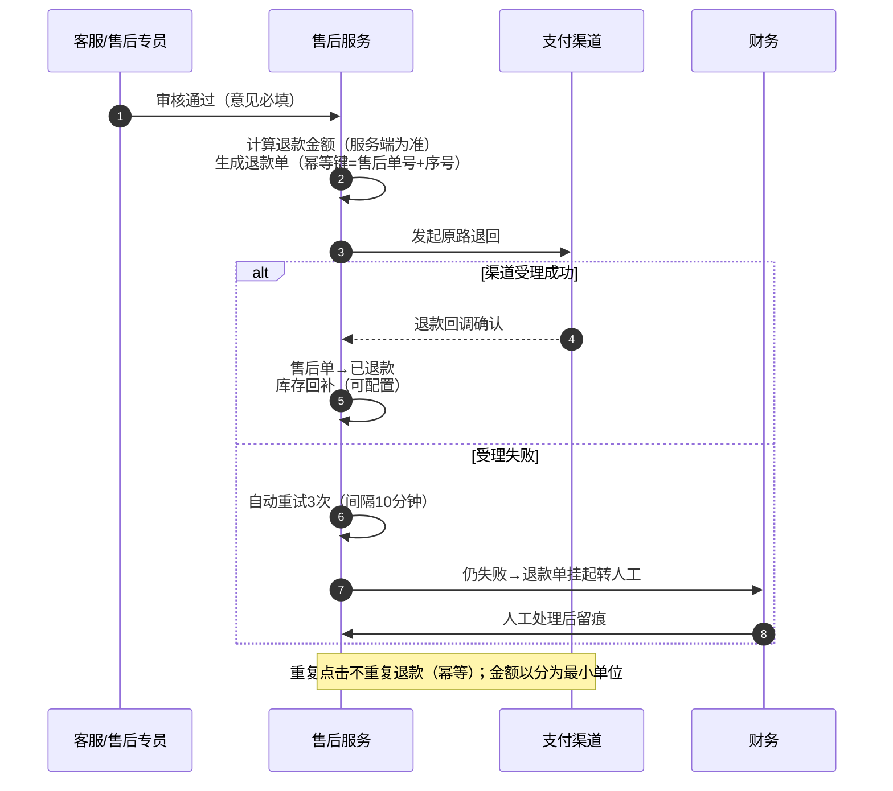
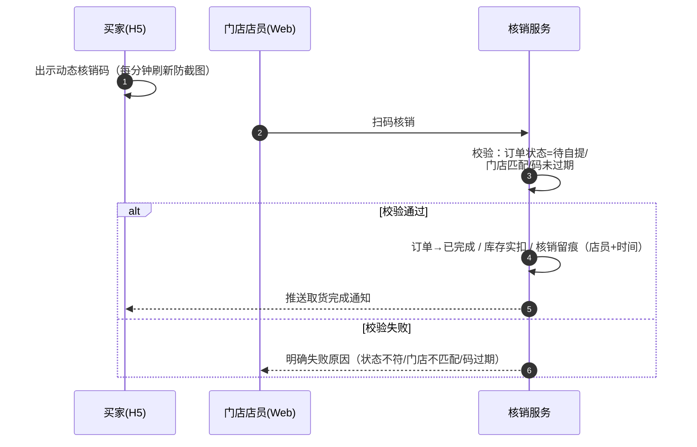
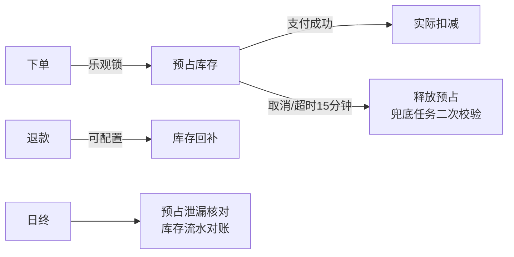
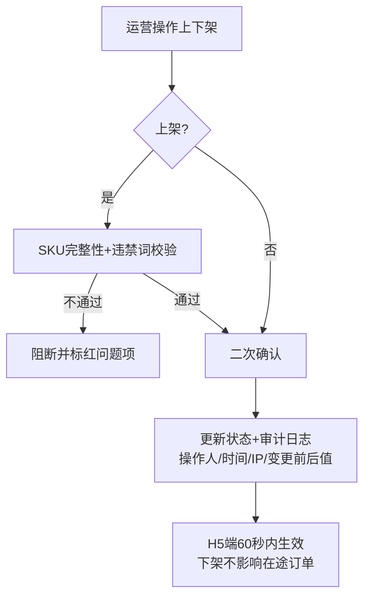

# 槟榔商城产品需求文档（PRD）

> 版本 v1.0 ｜ 撰写：司南（资深产品经理 Agent）

---

## 一、文档信息

| 项目   | 内容                                                                                               |
| ---- | ------------------------------------------------------------------------------------------------ |
| 文档名称 | 槟榔商城产品需求文档（H5 商城端 + Web 管理端）                                                                     |
| 版本号  | v1.2                                                                                             |
| 作者   | 司南（产品）                                                                                           |
| 日期   | 2026-10-22                                                                                       |
| 变更记录 | v1.0 首次成稿；v1.1 H5 端参考正隆记小程序风格（门店切换/到店自提核销/领券中心）；v1.2 按业务决策移除合规中心与系统设置（RBAC）模块，相关底线要求收编至安全需求与人工流程；v1.3 第八章新增 8.4 流程图与时序图（Mermaid 源码 + HTML 渲染版）；v1.4 按业务决策移除售卖区域限制功能（全区域可售，同步清理 E-06 异常项与附录 C 清单项）；H5 收货地址落地为纯文本输入增删改查（无地图定位），原型已实现地址列表与编辑表单；v1.5 优惠券模块整体移除（领券中心/掌柜礼包/后台券配置/结算用券，FR-15 编号保留占位）；v1.6 库存模块补齐：库存口径三维展示（实物=可用+预占+冻结）、入库单（批次必填）、盘点单二级确认、冻结/释放、阈值可编辑、流水含冻结/释放并日终核对，Web 原型库存页改为总览/流水/盘点三页签全交互；v1.7 售后补流转记录（FR-06-5：双端时间线、不可删改，H5 新增售后详情页、Web 工单详情含时间线）；H5 收货地址演示数据补第二条非默认地址使「设为默认」可操作；v1.8 移除商品资质字段（生产许可证/检验报告）：新增商品表单不再收集、上架校验不含资质项、详情页不再展示，依赖表阻塞项同步删除（FR-10-5 编号保留占位） |
| 评审记录 | 待评审                                                                                              |

> ⚠️ **品类合规前置声明（强监管）**：槟榔在中国属于强监管品类。2022 年起国家市场监管总局及广电总局明确要求停止槟榔的广告宣传推广，多地禁止或限制销售。本商城定位为**已有线下合规资质的商户自有渠道**，禁止一切对外广告投放、功效宣传与诱导营销。上线前必须完成合规评审（见附录 C 合规专项清单），未通过不得上线。

---

## 二、背景与目标

### 2.1 背景（待补充确认）

- 假设：用户为槟榔品牌方/经销商，已有线下销售渠道与合规资质，希望搭建自有线上商城（H5 触达消费者 + Web 后台运营管理），实现商品管理、线上交易、会员沉淀与售后闭环。
- 当前痛点：线下依赖批发/铺货，缺少会员数据沉淀；无线上交易与库存联动；售后无系统记录。

### 2.2 目标与成功指标

| 指标      | 口径                   | 目标值（估算，首季） |
| ------- | -------------------- | ---------- |
| 会员注册数   | 完成手机号注册且去重的账号数       | ≥ 5,000    |
| 支付成功率   | 支付成功订单数 ÷ 提交订单数      | ≥ 90%      |
| 售后完结时长  | 售后申请到退款到账 P75 时长     | ≤ 72 小时    |
| 库存准确率   | 盘点实际库存与系统库存一致 SKU 占比 | ≥ 99%      |
| 订单履约及时率 | 48 小时内发货订单占比         | ≥ 95%      |

### 2.3 名词与术语定义

| 术语        | 定义                            |
| --------- | ----------------------------- |
| SPU / SKU | 标准产品单元 / 库存量单位（口味、规格为 SKU 属性） |
| 上下架       | 商品对买家可见可买（上架）/ 不可见不可买（下架）     |
| 售后        | 买家对已完成/已签收订单发起的退货、退款申请        |
| 资损三件套     | 幂等、对账、资损监控（资金类需求必做，不可砍）       |
| 警示语       | 平台强制的健康提示文案，商品详情页必须展示         |

---

## 三、需求范围

### 3.1 包含（本期）

| 端       | 模块                                                                        |
| ------- | ------------------------------------------------------------------------- |
| H5 商城端  | 注册登录、商品浏览/搜索、商品详情、购物车、下单支付、订单管理、会员中心（等级/积分）、售后申请、地址管理、个人中心            |
| Web 管理端 | 商品管理（新增/修改/上下架/分类）、库存管理（入库/预警/盘点）、**门店管理（门店信息维护 / 到店自提核销记录）**、订单管理（发货/导出/待自提）、售后处理（审核/退款）、会员管理（掌柜卡等级）、数据看板 |

### 3.2 不包含（本期不做）

- **账号权限模块（RBAC）与合规中心后台**（v1.2 按业务决策移除；文案合规改由线下人工流程承接，见 13.1 风险登记册）
- **商品资质字段（生产许可证/检验报告）**（v1.8 按业务决策移除：新增商品表单不再收集资质，上架校验不含资质项，商品详情页不再展示资质信息）
- **售卖区域限制功能**（v1.4 按业务决策移除，全区域可售，不做禁售区域配置与下单阻断）
- **优惠券模块**（v1.5 按业务决策移除：H5 领券中心、结算用券、会员券列表、后台券配置一并移除；营销让利后续如需再评估）
- 分销/裂变、拼团、秒杀等营销玩法（后续版本池）
- App / 小程序端（仅 H5）
- 自营物流系统（对接第三方快递单号录入）
- 发票开具（后续版本）
- 广告投放、直播带货等推广功能（**品类合规原因，永久不做**）

---

## 四、方案对比与选型说明

| 方案                                                     | 实现成本 | 复杂度 | 体验 | 风险                  | 上线时间         | 综合评价                              |
| ------------------------------------------------------ | ---- | --- | -- | ------------------- | ------------ | --------------------------------- |
| 方案 A：H5 商城 + Web 后台，自研商城核心（商品/订单/库存/会员），支付直接对接微信支付+支付宝 | 中    | 中   | 中  | 中                   | 快（估算 8-10 周） | **推荐**。控制成本，H5 无需应用商店审核，后台功能完整可运营 |
| 方案 B：基于成熟开源商城二开                                        | 低    | 低   | 中  | 高（开源合规与安全审计成本、定制受限） | 更快           | 备选。若工期极紧可选，需安全审计                  |
| 方案 C：全自研含 App/小程序多端                                    | 高    | 高   | 好  | 中                   | 慢            | 本期不做，留演进路径                        |

**推荐方案 A**。演进路径：本期 H5+Web → 触发条件「H5 注册用户 > 3 万且留存达标」→ 后续迭代微信小程序端与营销玩法模块。

---

## 五、用户角色与使用场景

| 角色      | 端   | 核心场景                         | 频次       |
| ------- | --- | ---------------------------- | -------- |
| 消费者（买家） | H5  | 浏览商品、加购、下单支付、查订单、申请售后、看积分 | 周 1-3 次  |
| 运营人员    | Web | 新增/修改商品、上下架、处理售后、会员运营  | 日 1-5 次  |
| 库管员     | Web | 入库、盘点、处理库存预警                 | 日 1 次    |
| 客服/售后专员 | Web | 处理售后审核、退款、客诉跟进               | 日 5-20 次 |
| 管理员     | Web | 账号权限管理、数据看板、资金对账             | 周 1-2 次  |

---

## 六、功能需求

> 状态词统一：必须（shall）/ 应该（should）/ 可以（may）/ 禁止（must not）。所有金额以「分」为单位存储与计算（Decimal），禁止浮点。

### 6.1 H5 商城端

**FR-01 注册登录**

- FR-01-1：必须支持手机号 + 短信验证码登录；新手机号自动注册。
- FR-01-2：必须支持微信授权登录（H5 公众号 OAuth）；微信与手机号可绑定合并账号。
- FR-01-3：验证码必须 60 秒内不可重发，单日单号上限 10 条；验证码 5 分钟有效。
- FR-01-4：登录态有效期必须为 7 天，支持静默续期；退出登录清除本地 token。
- 验收（GWT）：Given 已注册手机号，When 输入正确验证码点击登录，Then 登录成功并跳转来源页，1 秒内完成。

**FR-02 商品浏览与详情**

- FR-02-1：必须提供首页（Banner + 分类导航 + 商品列表）、分类页、搜索页（按商品名/条码搜索，支持拼音首字母）。
- FR-02-2：商品详情必须展示：主图轮播、名称、规格（SKU 选择器）、价格、销量（可选展示）、库存状态、**警示语（固定文案：「长期过量咀嚼槟榔，有害口腔健康」）**、产地信息。
- FR-02-3：**禁止展示任何功效性宣传文案（提神、醒脑、健康功效等）**；商品名称与描述上架前必须经人工复核（运营初审 + 法务复审，线下流程）。
- FR-02-4：SKU 缺货时必须置灰不可选，并可开启「到货提醒」；下架商品详情页必须展示「该商品已下架」且禁止下单。
- FR-02-5：未成年人访问不得推送任何商品推荐；详情页必须展示「不向未成年人销售」提示（固定文案）。

**FR-03 购物车**

- FR-03-1：必须支持加入购物车、修改数量、删除、勾选/取消勾选、全选；未登录加购的商品在登录后必须合并到账号购物车（本地购物车合并策略：同 SKU 数量累加，上限各 999）。
- FR-03-2：购物车必须实时展示：勾选商品合计金额、库存不足标识（库存变化后进入购物车页时刷新）。
- FR-03-3：单账号购物车 SKU 上限 100；超限提示「购物车已满」。
- FR-03-4：已下架/失效商品必须置灰并提示「商品已失效」，不可结算，可一键清除失效商品。

**FR-04 下单与支付（资金核心）**

- FR-04-1：结算页必须展示：商品清单、数量、单价、运费、应付合计；金额计算必须以服务端为准，明细可追溯（页面展示值 = 服务端返回值）。
- FR-04-2：提交订单必须携带幂等键（客户端 UUID，服务端 5 分钟内去重），**重复点击不产生重复订单**。
- FR-04-3：下单时必须校验库存（乐观锁扣减预占），库存不足时返回明确缺货 SKU 与剩余可购数量。
- FR-04-4：必须支持微信支付与支付宝；**依赖说明：支付渠道对槟榔类目可能有准入限制，上线前必须完成商户号类目报备验证（阻塞依赖，见 13.2）**。
- FR-04-5：订单待支付超时必须为 15 分钟，超时自动关闭并释放库存预占（延时任务 + 关闭时二次校验支付状态）。
- FR-04-6：支付结果必须以「回调 + 主动查询」双通道确认；回调丢失时前端轮询查询接口（3 秒/次，共 10 次）。
- FR-04-7：单笔订单实付金额上限必须为 5,000 元（风控）。
- FR-04-8：必须支持两种履约方式：快递配送（满 99 包邮）与到店自提（免运费，到店报手机尾号出示核销码由门店扫码核销）；核销码必须每分钟自动刷新防截图盗用，仅限门店现场使用；H5 端支持切换所属门店（门店由后台「门店管理」维护，商品/核销跟随门店）。

**FR-05 订单管理（买家）**

- FR-05-1：订单列表按状态筛选：待支付/待发货/待收货/已完成/售后中；必须支持按时间倒序分页加载。
- FR-05-2：待支付订单可以取消支付（释放库存）；待收货订单可以确认收货；确认收货必须二次确认弹窗。
- FR-05-3：订单详情必须展示：订单号、商品明细、金额明细、支付方式、收货信息、物流单号（可跳转查询）、状态与时间轴。
- FR-05-4：已签收后 7 天内可发起售后申请（入口在订单详情）。

**FR-06 售后（买家侧）**

- FR-06-1：售后类型必须为：仅退款（未发货/未签收）、退货退款（已签收 7 天内且商品未拆封）。**已拆封食品类商品不予退货，仅支持质量问题协商退款**（规则在 Web 端可配置）。
- FR-06-2：申请必须填写：原因（下拉枚举）、描述（选填）、凭证图片（1-3 张，选填，质量问题必填）。
- FR-06-3：退款金额规则：未发货全额退款（含运费）；退货退款按实付金额原路退回。
- FR-06-4：买家可以撤销售后（仅限商家未审核前）；审核拒绝后可以重新申请（每个订单每 SKU 限 3 次）。
- FR-06-5：**售后流转记录**：售后单每流转一步（买家提交/系统受理/商家审核通过或拒绝/买家寄回/商家确认收货/退款中/退款成功或关闭）必须生成流转记录（时间、操作方、动作、备注/凭证/物流单号）；买家 H5 端「售后详情」与 Web 商家端「工单详情」均可查看完整时间线；**记录不可删除、不可修改**，作为售后争议的判定依据。

**FR-07 会员中心**

- FR-07-1：会员等级必须按「累计实付消费金额」自动升级：V0 普通 → V1（≥500 元）→ V2（≥2,000 元）→ V3（≥5,000 元）；等级只升不降（年度内），规则阈值 Web 端可配置。
- FR-07-2：积分规则：实付 1 元 = 1 积分，退款按比例扣减；积分可以抵现（100 积分 = 1 元，单笔订单抵扣上限为实付金额的 5%）。**积分规则仅作为消费回馈，禁止设计签到激励复购等成瘾性/诱导性玩法**。
- FR-07-3：会员中心页面必须展示：等级与权益、积分余额与明细。

**FR-08 地址与个人中心**

- FR-08-1：必须支持收货地址增删改查、默认地址设置，上限 20 条；所在地区与详细地址均为**纯文本输入**，不做地图选点/定位（v1.4 确认）；删除需二次确认。
- FR-08-2：个人中心：订单入口、售后入口、会员信息、客服入口（工作日 9:00-18:00，展示客服电话）。

### 6.2 Web 管理端

**FR-10 商品管理**

- FR-10-1：必须支持商品新增：填写名称、分类（二级）、品牌、SPU 描述、SKU 列表（口味/规格/条码/售价/成本价/库存）、主图（≥3 张）、详情图、产地。
- FR-10-2：必须支持商品编辑：修改后保存即生效；改价对未支付订单不生效、对新订单生效；必须保留修改记录（操作人/时间/字段变更前后值，审计日志）。
- FR-10-3：必须支持批量上下架与单个上下架；下架即时生效；下架不影响在途订单履约。
- FR-10-4：商品列表必须支持按分类/状态/名称/条码筛选与分页；导出 Excel。
- FR-10-5：（v1.8 已移除——资质信息字段与「资质未上传禁止上架」校验按业务决策删除，编号保留占位）

**FR-11 库存管理**

- FR-11-1：库存口径必须为：**实物库存 = 可用库存 + 预占 + 冻结**；所有列表页必须同时展示三个维度。
- FR-11-2：入库必须以「入库单」为单位：SKU、数量（>0）、批次号（必填）、供应商（选填）、备注（选填）；入库单确认后生成「入库」流水。
- FR-11-3：盘点必须以「盘点单」为单位：库管员填写实盘数、差异自动计算 → **管理员二级确认**（提交人不得同时担任确认人）→ 确认后按差异修正库存并生成「盘点修正」流水。
- FR-11-4：必须支持 SKU 级冻结/释放：冻结后可用库存清零（H5 端立即售罄置灰），预占中的订单不受影响；冻结/释放均生成流水。
- FR-11-5：库存扣减链路必须为：下单预占 → 支付成功实际扣减 → 取消/超时释放预占；预占必须有超时释放兜底任务（15 分钟）。
- FR-11-6：安全阈值每 SKU 可配（默认 50，修改留审计日志）；可用库存低于阈值触发站内预警 + 企业微信/短信通知库管员（同 SKU 24 小时内不重复推送）。
- FR-11-7：库存流水必须完整可追溯（来源：入库/订单扣减/退款回补/盘点修正/冻结/释放，含关联单号），**不可删除、不可修改**；日终核对「实物库存 = Σ流水」，差异触发告警。

**FR-12 订单管理（商家侧）**

- FR-12-1：订单列表：按状态/订单号/手机号（脱敏展示）/下单时间筛选；支持批量发货（Excel 导入物流单号，导入校验失败行回显原因）。
- FR-12-2：发货必须填写物流公司+单号，保存后买家端可见；支持修改物流单号（仅限未签收）。
- FR-12-3：订单导出：支持按时间范围导出，导出任务异步生成，包含金额明细；导出权限仅限管理员与运营。
- FR-12-4：待发货超 24 小时未处理必须高亮提醒。

**FR-13 售后处理（商家侧）**

- FR-13-1：售后工单列表与详情：必须展示买家申请信息与凭证；审核操作必须填写审核意见；**详情页必须包含完整流转记录时间线（FR-06-5），审核通过/拒绝后实时追加记录并同步买家端**。
- FR-13-2：审核通过后：仅退款 → 触发原路退款（调用支付渠道退款接口，幂等，退款单号=售后单号+序号）；退货退款 → 待买家寄回 → 商家确认收货 → 触发退款 → 库存回补（可配置是否回补）。
- FR-13-3：审核超时（48 小时未处理）必须升级提醒至管理员。
- FR-13-4：**资金底线：退款必须幂等（重复点击不重复退款）、金额以服务端计算为准、退款成功以渠道回调确认为准**。

**FR-14 会员管理**

- FR-14-1：会员列表：手机号（脱敏）、等级、积分、累计消费、注册时间；支持导出（脱敏后导出）。
- FR-14-2：等级阈值与积分规则可配置（管理员权限，修改留审计日志）。
- FR-14-3：支持人工调整积分（备注原因，双重确认）。

**FR-15 优惠券配置（v1.5 按业务决策移除，编号保留占位）**

**FR-16 数据看板**

- FR-18-1：核心指标：GMV、订单数、支付成功率、客单价、售后率（售后单数÷已完成订单数）、退款金额、库存周转。口径见第十节。
- FR-18-2：支持按日/周/月查看，T+1 更新。

---

## 七、非功能需求

| 类别   | 要求                                                                              |
| ---- | ------------------------------------------------------------------------------- |
| 性能   | H5 页面首屏加载 ≤ 2s（P75）；商品列表接口 ≤ 500ms（P95）；提交订单接口 ≤ 800ms（P95）；支持峰值 100 QPS 下单（估算） |
| 安全   | 全站 HTTPS；敏感字段（手机号）存储加密、展示脱敏；接口防刷（验证码/登录/下单限流）；管理端操作审计                           |
| 兼容   | H5 兼容 iOS Safari 14+、Android Chrome 80+、微信内置浏览器；管理端兼容 Chrome 100+               |
| 可用性  | 核心交易链路可用性 ≥ 99.5%；支付回调处理支持断点重试                                                  |
| 可访问性 | 关键按钮文字与背景对比度 ≥ 4.5:1；图片有 alt 描述                                                 |
| 数据留存 | 订单与资金流水留存 ≥ 5 年；审计日志 ≥ 2 年                                                      |

---

## 八、业务流程与状态流转

### 8.1 下单主流程

浏览商品 → 加入购物车 → 结算 → 提交订单（幂等+库存预占）→ 支付 →（成功：扣库存、生成待发货）/（失败或超时：关单释放库存）→ 发货 → 签收 → 已完成 →（7 天内可售后）。

### 8.2 订单状态机

| 当前状态 | 触发事件              | 迁移到 | 允许操作        |
| ---- | ----------------- | --- | ----------- |
| 待支付  | 支付成功              | 待发货 | 取消、去支付      |
| 待支付  | 超时 15 分钟 / 买家取消   | 已关闭 | —           |
| 待发货  | 商家发货              | 待收货 | 申请仅退款       |
| 待收货  | 物流签收 / 买家确认收货     | 已完成 | 查看物流、申请退货退款 |
| 已完成  | 发起售后              | 售后中 | 申请售后        |
| 售后中  | 退款完成 / 撤销 / 拒绝后超时 | 已完成 | —           |

> 状态必须单向流转，禁止回跳（已关闭 → 待支付 须重新下单）；所有状态变更由服务端事件驱动。

### 8.3 售后状态机

申请中 → （商家审核）→ 审核通过：仅退款 → 退款中 → 已退款；退货退款 → 待买家寄回 → 商家确认收货 → 退款中 → 已退款 / 审核拒绝 → 已拒绝（可重新申请，限 3 次）/ 买家撤销 → 已关闭。

### 8.4 流程图与时序图（Mermaid 源码；渲染版见交付文件 `槟榔商城-时序图与流程图.html`）

**图 1：下单支付主流程**



**图 2：支付结果确认时序图**



**图 3：订单状态机**



**图 4：退款时序图（资金·幂等）**



**图 5：到店自提核销时序图**



**图 6：库存扣减链路**



**图 7：商品上下架流程（管理端）**



---

## 九、数据与埋点需求

### 9.1 核心指标口径

| 指标    | 口径                      | 统计周期 |
| ----- | ----------------------- | ---- |
| GMV   | 支付成功订单实付金额合计（不含已全额退款订单） | 日    |
| 支付成功率 | 支付成功订单数 ÷ 提交订单数         | 日    |
| 售后率   | 售后申请单数 ÷ 已完成订单数         | 月    |
| 客单价   | GMV ÷ 支付成功订单数           | 日    |

### 9.2 埋点事件（最小集）

| 事件                            | 触发时机      | 关键属性               |
| ----------------------------- | --------- | ------------------ |
| pv_page                       | 页面曝光      | page_id、来源渠道       |
| goods_view                    | 商品详情曝光    | spu_id、sku_id、来源   |
| add_cart                      | 加入购物车     | sku_id、数量          |
| submit_order                  | 提交订单      | order_id、金额            |
| pay_result                    | 支付回调确认    | order_id、结果、支付渠道   |
| refund_submit / refund_result | 售后申请/退款完成 | aftersale_id、金额、原因 |

---

## 十、权限与安全要求

> v1.2 修订：RBAC 账号权限模块与合规中心后台已按业务决策移除（见 3.2）。保留以下安全底线要求，由研发在系统层面实现，不做独立后台页面：

- 管理端登录必须账密 + 短信二次验证；连续 5 次失败锁定 30 分钟。
- 操作审计日志：所有资金相关与商品上下架操作必须记录操作人/时间/IP/变更内容，日志保留 ≥ 2 年。
- 健康警示语与未成年人提示强制展示，为 H5 端的硬编码规则（见 FR-02-2 / FR-02-5），不依赖后台配置页面。商品资质字段已按业务决策移除（v1.8），资质核验由线下人工流程承接。

**资金安全三件套（必做，不可砍）**

1. **幂等**：下单幂等键（客户端 UUID + 服务端 5 分钟去重）；支付/退款幂等键 = 业务单号 + 渠道流水号。
2. **对账**：每日 T+1 与微信支付/支付宝账单自动对账；差异生成对账差异表（订单号/渠道单号/金额差），财务确认处理，处理留痕。
3. **资损监控**：四类告警必须实现——重复支付（同订单多笔成功）、负金额/金额异常（单笔 > 5,000 元）、状态回跳（已完成 → 待支付）、对账差异未处理超 24h。告警推送至财务 + 超管，30 分钟未响应升级短信。

---

## 十一、异常处理清单

| #    | 场景         | 处理                                                  |
| ---- | ---------- | --------------------------------------------------- |
| E-01 | 断网/弱网提交订单  | 前端提示网络异常，订单查询接口确认是否已创建，防重复提交                        |
| E-02 | 支付回调丢失     | 前端轮询 + 定时对账补偿任务扫描「支付中」超 10 分钟订单主动查询渠道               |
| E-03 | 库存超卖       | 乐观锁 + 预占机制；预占失败返回明确缺货提示                             |
| E-04 | 退款渠道失败     | 退款单挂起，自动重试 3 次（间隔 10 分钟），仍失败转人工（财务），买家端可见「退款处理中」    |
| E-05 | 商品价格配置错误   | 管理端改价需二次确认；异常低价（低于成本价 70%）触发风控拦截提示复核                |
| E-06 | 用户申请超时/误操作 | 每个危险操作（取消订单、确认收货、删除地址）二次确认                          |
| E-07 | 管理员误下架热销商品 | 审计日志可追溯操作人，一键恢复上架                                   |

---

## 十二、上线计划、依赖与上线后验证

### 12.1 里程碑（估算，以人力确认后为准）

| 阶段 | 内容                         | 周期（估算） |
| -- | -------------------------- | ------ |
| M1 | 后台：商品/库存/权限 + H5：登录/商品/购物车 | 3 周    |
| M2 | 交易闭环：下单/支付/订单 + 后台订单管理     | 3 周    |
| M3 | 售后 + 会员 + 数据看板             | 2 周    |
| M4 | 联调、对账、资损监控、灰度上线            | 2 周    |

灰度策略：先内部账号（白名单）→ 10% 新用户 → 全量；回滚方案：H5 支持功能开关（营销/会员可独立关闭），交易模块异常时关闭下单入口并公告。

### 12.2 依赖评估

| 依赖项                    | 所属方      | 就绪状态 | 分级     | 最晚就绪时限   | 影响与替代方案                    |
| ---------------------- | -------- | ---- | ------ | -------- | -------------------------- |
| 微信支付/支付宝商户号 + 槟榔类目报备通过 | 用户/支付渠道  | 待确认  | **阻塞** | M2 开发启动前 | 若类目受限，评估仅限企业 B2B 结算或调整业务模式 |
| 短信服务商（验证码/通知）          | 第三方      | 可选型  | 并行     | M2 联调前   | 备选双服务商                     |
| 物流轨迹查询接口               | 快递 100 等 | 可选型  | 可绕过    | M3 联调前   | 缺失时展示物流公司+单号，用户自行查询        |

### 12.3 上线后验证

上线 72 小时内：核对支付对账零差异、验证幂等（重复提交压测）、售后全流程演练 1 单、资损告警演练触发 1 次；T+7 复盘核心指标（2.2）。

---

## 十三、风险与遗留问题

### 13.1 风险登记册

| 编号    | 风险描述                      | 类别    | 概率 | 影响 | 等级   | 应对措施                                          | 责任人   | 状态  |
| ----- | ------------------------- | ----- | -- | -- | ---- | --------------------------------------------- | ----- | --- |
| RK-01 | 槟榔类目无法通过微信/支付宝商户报备，交易无法闭环 | 合规    | 3  | 5  | 15 高 | 上线前先行报备验证；准备 B2B 结算替代方案                       | 用户+财务 | 跟踪中 |
| RK-02 | 监管/地方政策变化导致品类经营要求调整       | 合规    | 4  | 4  | 16 高 | 指定专人每月跟踪监管与地方政策变化，及时调整经营策略与商品结构 | 运营    | 跟踪中 |
| RK-03 | 商品文案命中广告法/功效宣传风险          | 合规    | 3  | 4  | 12 中 | 上架前人工双审（运营初审+法务复审）；文案规范培训；违规商品立即下架            | 运营+法务 | 跟踪中 |
| RK-04 | 支付对账差异/退款失败引发资损           | 技术/资金 | 2  | 5  | 10 中 | 资金三件套 + 告警 30 分钟响应机制                          | 财务    | 跟踪中 |
| RK-05 | 库存预占泄漏导致超卖或可售库存虚高         | 技术    | 2  | 4  | 8 中  | 预占超时释放兜底任务 + 日终库存核对                           | 后端    | 跟踪中 |
| RK-06 | H5 在微信内被风控限制访问            | 技术    | 2  | 3  | 6 低  | 域名备案与合规自查；准备备用域名                              | 技术    | 观察  |


### 13.2 遗留问题

| # | 问题 | 处理 |
|---|------|------|
| Q-01 | 发票开具能力 | 记入后续版本池，M3 后评估 |
| Q-02 | 营销玩法（拼团/秒杀） | 后续版本池，触发条件见 4.2 演进路径 |
| Q-03 | 商户号类目报备结果 | 待用户确认（阻塞项 RK-01） |
| Q-04 | 账号权限（RBAC）与合规中心模块已移除，多角色精细化授权暂无系统支撑 | 记入后续版本池；过渡期靠「固定角色约定 + 人工复核」承接，团队扩编前建议恢复 |

---

## 十四、附录 A：原型思路（线框描述）

> v1.1 修订：H5 端视觉与交互参考「正隆记」微信小程序风格——红金国潮老字号风（品牌印记「正隆記 · 正宗湘潭门店究头 · 始于一九一六」、八字宗旨「以正立本，以究待客」、四正本纪「正品/正源/正工/正心」），顶部门店切换、掌柜礼包四档券、门店核销码、到店自提。交付 HTML 原型文件：`槟榔商城-H5原型.html` 与 `槟榔商城-Web管理端原型.html`（原型中商品名/门店/文案为参考示意，正式上线前需品牌方确认授权使用）。
> v1.2 修订：Web 管理端与 H5 需求对齐——红金品牌视觉、商品数据按「究」系列档位、新增「门店管理」（门店信息 + 到店自提核销记录）、订单支持「待自提」状态与核销操作、会员体系同步掌柜卡等级。v1.5 修订：优惠券模块（领券中心/掌柜礼包/后台券配置/结算用券）按业务决策整体移除。

### A.1 H5 商城端页面流程

首页 → 分类/搜索 → 商品详情 → 购物车 → 确认订单 → 支付 → 结果页 → 订单列表/详情 → 售后申请。

**关键页面线框**

```
页面：商品详情页
目标：让买家快速了解商品并完成加购/下单
布局：
- 顶部：导航栏（返回 / 标题 / 购物车入口含角标）
- 内容区：主图轮播（指示器）→ 商品名（超长省略，点开看全文）→ SKU 选择行 →
  价格（大号红字）+ 销量 → 库存状态 → 警示语条（灰底，不可关闭）→
  产地信息（折叠面板）→ 商品详情长图
- 底部：吸底操作栏「加入购物车 | 立即购买」
交互：
- SKU 面板从底部弹出；缺货 SKU 置灰且数量不可增
- 加购成功 Toast + 购物车角标 +1；立即购买跳过购物车直接结算
- 已下架：吸底栏替换为「商品已下架」，置灰不可点
- 「不向未成年人销售」固定提示语位于详情底部

页面：确认订单页
布局：
- 收货地址卡片（无地址时展示「+ 新增收货地址」；点击卡片跳转地址列表页）
- 地址列表页：地址卡片（收货人/脱敏手机号/地区+详细地址/默认标），卡片操作「编辑 / 删除 / 设为默认」；结算场景下点击卡片即选用并返回
- 地址编辑表单（纯文本输入，无地图定位）：收货人*、手机号*（11 位校验）、所在地区*（省/市/区）、详细地址*、设为默认开关
- 商品清单 →
  金额明细（商品合计/运费/应付）→ 提示语「不向未成年人销售」
- 底部：吸底「应付 ¥xx  提交订单」
交互：
- 提交按钮防重复点击（点击后 loading，1.5s 内不可再点）
- 库存不足返回时弹窗列出缺货 SKU，提供「移除缺货商品」快捷操作
- 支付失败/取消：保留订单，订单详情页可继续支付（15 分钟内）
```

### A.2 Web 管理端信息架构

```
左侧导航（2 级）：
├ 工作台（待办：待发货/待售后审核/库存预警汇总）
├ 商品管理：商品列表 / 新增商品 / 分类管理
├ 库存管理：库存总览（实物/预占/可用/阈值/冻结）/ 库存流水 / 盘点单（二级确认）
├ 订单管理：订单列表 / 批量发货 / 导出记录
├ 售后管理：售后工单列表 / 工单详情（含流转记录时间线）
├ 会员管理：会员列表 / 等级规则 / 积分规则 / 积分调整
├ 数据看板
└ （v1.2：合规中心 / 系统设置已按业务决策移除）
```

```
页面：商品新增/编辑（核心）
布局：
- 左侧步骤锚点：基本信息 → SKU 与价格 → 图片与详情 → 提交
- 基本信息：名称（上架前人工双审，线下流程）、二级分类、品牌、产地
- SKU 表格：行 = 口味×规格，列 = 条码/售价/成本价/库存/状态；支持批量填价
- 图片：主图 ≥3 张拖拽排序；详情长图上传
- 提交：二次确认弹窗展示变更摘要（编辑态）
交互：
- 保存草稿 / 提交上架（SKU 完整性校验：条码唯一/售价>0/库存≥0，缺失项标红定位）
- 修改售价时弹窗提示「对新订单生效」
```

```
页面：售后工单详情
布局：
- 工单头：单号/状态/申请时间（超 48h 红色高亮）
- 左：买家申请信息（原因/描述/凭证大图预览）+ 订单快照
- 右：审核操作区（通过/拒绝 + 意见必填）→ 退款金额（服务端算好，只读）→
  退款按钮（资金角色权限，二次确认）
- 下方：**流转记录时间线**（申请提交 → 系统受理 → 审核通过/拒绝 → 买家寄回 →
  确认收货 → 退款中 → 退款成功，每节点含时间/操作方/备注，不可删改）
交互：
- 退款按钮点击后 loading 至渠道受理结果返回；失败可重试（幂等）
- 审核操作完成后自动追加流转记录（买家 H5 端同步可见）

页面：售后详情（H5 买家端）
布局：
- 工单卡：工单号 / 售后类型 / 原因 / 退款金额
- 流转记录时间线（与商家端同一数据源，节点同上）
入口：「我的-售后记录」/ 提交售后申请成功后自动进入
交互：
- 提交申请 → 生成工单并跳转售后详情，实时可见「系统受理」等节点
- 全程操作留痕时间轴展示在页底
```

---

## 十五、附录 B：需求追踪矩阵（RTM 节选）

| 需求编号 | 需求描述 | PRD 章节 | 测试用例方向 | 状态 |
|----------|----------|----------|--------------|------|
| FR-01-1 | 手机号验证码登录 | 6.1 | TC-登录-01 | 待排期 |
| FR-04-2 | 下单幂等防重 | 6.1 / 10 | TC-交易-幂等-01 | 待排期 |
| FR-10-3 | 批量上下架 60s 生效 | 6.2 | TC-商品-03 | 待排期 |
| FR-13-4 | 退款幂等 | 6.2 / 10 | TC-售后-资金-01 | 待排期 |
| FR-16-1 | 数据看板核心指标 | 6.2 | TC-数据-01 | 待排期 |

## 附录 C：品类合规专项清单（上线前逐项确认）

- [ ] 商户支付渠道槟榔类目报备结果确认（RK-01）
- [ ] 商户线下经营资质（营业执照/食品经营许可等）线下核验留存（资质字段已移出系统，v1.8，由线下人工承接）
- [ ] 警示语与健康提示已强制植入且不可删除
- [ ] 商品文案上架前人工双审通过（运营初审 + 法务复审），无任何功效宣传与广告法违禁词
- [ ] 未成年人保护提示语展示于详情页与结算页
- [ ] 无广告投放、无直播带货、无诱导性营销设计
- [ ] 用户隐私政策与个人信息收集告知（PII 脱敏展示）已完成

---

**本方案为产品设计参考，具体实施请结合公司合规与法务要求确认。**
